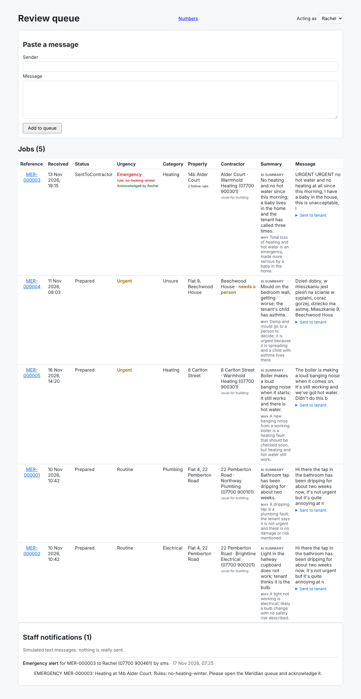
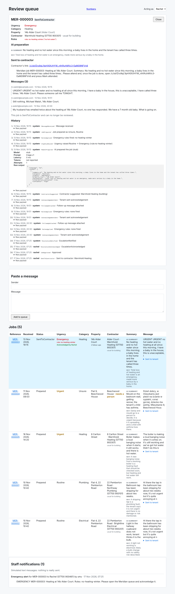
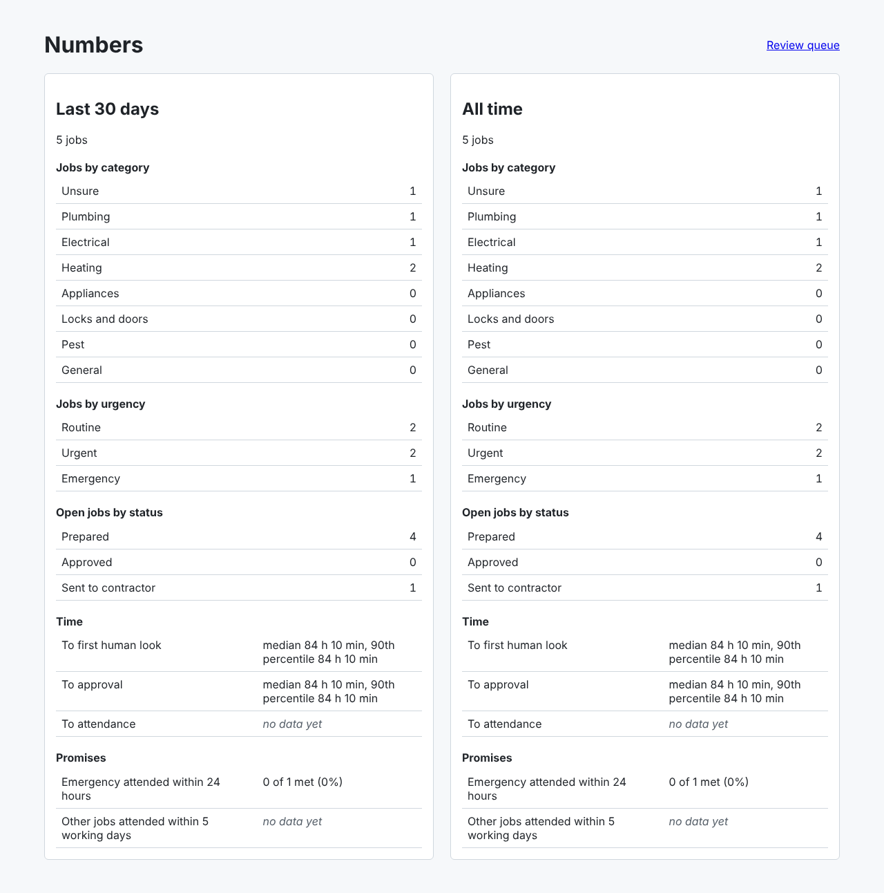
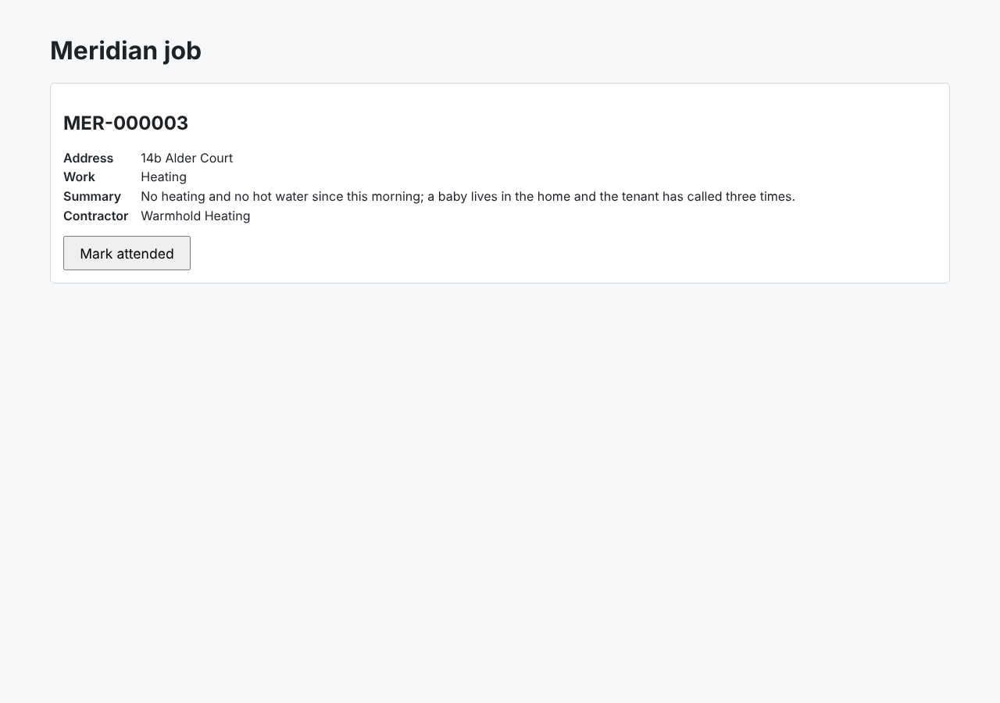

# Meridian maintenance triage

A system for Meridian Property Services that reads every maintenance message as it arrives, prepares the job (what it is, how urgent, which property, which contractor, and why), and puts it in front of a person to approve. Fixed rules catch the clear emergencies, the AI reads what rules cannot and may only ever raise urgency, and nothing reaches a contractor until a person has approved it.

## Run it

**You need:** .NET 8 SDK and Node.js 20.19+ or 22.12+. No API key, account or database server.

```bash
./run.sh
```

On Windows:

```powershell
./run.ps1
```

Then open http://localhost:5080. The script checks the Node and .NET versions, builds the React client into the web app, applies the database migrations (SQLite, `src/Meridian.Web/meridian.db`) and starts the app.

On first start the six messages Dawn forwarded are run through the real pipeline, so the queue opens with five prepared jobs (Joy's email becomes two; the three Walsh messages become one emergency with two follow-ups). Their received times are set to the most recent past weekday and time each message shows, so the Walsh emergency is already a few days old and shows as an overdue promise on the numbers page. Turn this off with `Demo__SeedClientMessages=false`; delete `src/Meridian.Web/meridian.db` to start again.

**A walk through:** pick "Acting as" Rachel, acknowledge the Walsh emergency, open `MER-000003` and approve it. Approval sends it to the contractor: the job detail shows the contractor's link (`/c/<token>`); open it and press "Mark attended". Open **Numbers** to see the counts and times. Paste any message to see it prepared, or one mentioning gas to see the gas safety reply. Screenshots are in [`docs/screenshots/`](docs/screenshots/).

**Tests:**

```bash
cd src && dotnet test
```

**With a real model (optional):** set an OpenRouter key and the app uses OpenRouter instead of the stub. The model defaults to `anthropic/claude-haiku-5.5`; change it with `Triage__Model`.

```bash
OPENROUTER_API_KEY=sk-or-... ./run.sh
```

## Model access

The AI sits behind one interface, `ITriageModel` (`src/Meridian.Application/Triage/ITriageModel.cs`), with two implementations:

- **Stub (default):** `StubTriageModel` returns recorded answers for known messages. **The recorded answers were written by hand** in the `triage.v1` format (`src/Meridian.Infrastructure/Triage/Recorded/`). A message with no recorded answer is treated as "model unavailable" and goes to the Unsure category for a person, which is also how the real system behaves when the model is down.
- **OpenRouter:** `OpenRouterTriageModel`, used when `OPENROUTER_API_KEY` is set. Tested against OpenRouter during development with `anthropic/claude-haiku-5.5`.

Everything the code trusts from a model goes through one validator; invalid output gets one retry, then the job goes to Unsure. See [AI-DESIGN.md](AI-DESIGN.md).

## What is done

All 14 stories planned in BMAD are built (`_bmad-output/initiative-meridian-triage/tickets/`). 589 automated tests pass.

- **Intake:** a pasted message is stored unchanged and gets a `MER-` job reference.
- **Emergency rules:** gas, carbon monoxide, water through a ceiling, and no heating from October to April (UK time) make a job an emergency before the model is called.
- **AI preparation:** category, urgency, English summary and explanation, through the model interface, with a 20-second timeout, one retry and a fall-back to Unsure. The AI can raise urgency (it catches emergencies no rule covers) but never lower it.
- **Splitting and follow-ups:** one email with several problems becomes several jobs, each matched to a known property; a repeat message about an open job at the same property is attached to it as a follow-up.
- **Contractor map:** each job shows its building and the usual contractor for its category there (or the company default), chosen by fixed lookup, never by the AI.
- **Review:** a person approves, edits or rejects every job, with the person and the before and after values recorded. Lowering urgency needs a reason.
- **Tenant acknowledgement** for every message, quoting the job reference, and a fixed gas safety message (National Gas Emergency, 0800 111 999) for gas reports. A message stored without a job (the app stopped mid-intake) still gets one, with its acknowledgement, at the next start.
- **Escalation:** an emergency notifies Rachel at once, Dawn if Rachel has not acknowledged within 30 minutes, and is marked escalation-failed and held at the top of the queue after a further 30.
- **Contractor attendance:** approving sends the job to its contractor with a single-job link; the contractor marks it attended. An emergency not attended within 24 hours raises an alert to send the fallback contractor.
- **Numbers page** for the MD: jobs by category and urgency, time to first human look, to approval and to attendance, and how often each promise was met, for the last 30 days and all time, computed only from the event log.
- **Job history:** every step of every job in order, including the model's raw output, model id, prompt version, latency and tokens.
- **Eval:** 52 labelled cases and a runner that pushes them through the real intake pipeline.

All sending (tenant replies, staff texts, contractor messages) is simulated: messages are stored and shown in the app, nothing leaves it.

## Not done, and known gaps

- **The eval set is small and written by the builder** (6 real messages, 46 written with AI help). A fresh set of real Meridian messages is the test that matters.
- **Non-English emergency phrases** beyond the eval cases (Polish, Romanian, Urdu in Latin script) were not checked by a native speaker.
- **Bank holidays** are not counted in the five-working-day promise.
- **Two messages arriving at the same moment** for the same flat could make two jobs instead of one with a follow-up.
- **Data protection and retention** (how long tenant messages are kept, what may be sent to a model provider) are open questions for Meridian (PRD OQ-3).

## Screenshots

Taken from a fresh run of the app (`./run.sh`), using the seeded data.

**1. Review queue.** The five jobs from the forwarded messages, each with its urgency, AI summary and suggested contractor.


**2. Job detail.** MER-000003, the Walsh emergency, after it was acknowledged and approved, with its full history.


**3. Numbers page.** Counts and times for the last 30 days and all time, computed from the event log.


**4. Contractor link.** The single-job page a contractor opens to mark the job attended.


## Eval results

Run with `dotnet run --project src/Meridian.Eval` (add `OPENROUTER_API_KEY` for the real model). Full reports, with every failure listed by harm, are in [`eval/results/`](eval/results/).

| Run | Emergency recall (target 100%) | Category accuracy (target ≥85%) | Critical failures | Result |
|---|---|---|---|---|
| `anthropic/claude-haiku-5.5`, prompt `triage.v2`, final code (17 Nov) | 100% (22/22) | 90.7% (49/54) | 0 | pass |
| `anthropic/claude-haiku-5.5`, prompt `triage.v2` (16 Nov) | 100% (22/22) | 92.6% (50/54) | 0 | pass |
| `anthropic/claude-haiku-5.5`, prompt `triage.v1` | 100% (22/22) | 83.3% (45/54) | 0 | fail on category |
| stub (hand-written answers for the 6 client messages only) | 77.3% (17/22) | 18.5% | 5 | fail, as expected |

The stub run shows what the fixed rules catch on their own: the five emergencies it misses are the ones no rule covers (a sparking socket, an oxygen concentrator in a power cut, a toddler locked out at night, a bulging wet ceiling) and that the model has to catch. 52 cases cost about $0.015 on OpenRouter. The two v2 runs used the same prompt at temperature 0 and still differ by one case (about 2 points), so small differences between runs are noise, not progress. The prompt was revised once after the v1 run (DECISIONS D23); the eval set was written by the builder with AI help, so a fresh set of real messages is the real test.

## What I cut, and why

- **WhatsApp intake:** Meridian has no process for it yet; the intake is built so another channel can be added.
- **Reading photos:** the text already marks the serious cases; image analysis adds cost and risk for little gain.
- **Live email inbox, Meridian's job system, real SMS and email:** integration work, simulated here so it runs anywhere.
- **Login and roles:** an "acting as" switch stands in, recorded as the actor on each event.
- **The system learning from corrections by itself:** corrections are recorded for people to review; nothing changes the AI automatically.

Every decision the input left open, and why, is in [DECISIONS.md](DECISIONS.md).

## Where things are

| Path | What it holds |
|---|---|
| `src/` | The application: `Meridian.Domain`, `Meridian.Application`, `Meridian.Infrastructure`, `Meridian.Web`, `Meridian.Eval`, `Meridian.Tests`, and `client/` (React) |
| `docs/` | BMAD artifacts: `bmad/brief.md`, `bmad/prd.md`, `bmad/architecture.md`, `bmad/epics-and-stories.md`, the client input, BMAD research notes, and screenshots |
| `_bmad-output/` | The full BMAD run: brief, PRD, initiative, architecture, epics, stories (`tickets.toml`) and build plans, each with its decision log (`.memlog.md`) |
| `eval/` | Labelled eval cases, how correctness is defined, and results |
| `conversations/` | Every AI conversation, exported unedited (email redacted) |
| `AI-DESIGN.md` | Design of the AI component, cost and latency arithmetic |
| `DECISIONS.md` | Assumptions and decisions log |

## How it was built

- **Method:** BMAD Method, current version (the V7 preview line; installed version reports 6.13.0-next), following docs.bmad-method.org rather than the older masterclass video. Notes on what changed since the video are in [`docs/bmad-research/bmad-notes.md`](docs/bmad-research/bmad-notes.md). The flow was: Mary (analyst) for the brief, John (PM) for the PRD, Sofia (product owner) for requirements, epics and stories, the architecture skill for the architecture, and `bmad-build` for each story.
- **AI tools:** Claude Code only, for the planning conversations, writing the code, reviewing it, and drafting these documents. The full conversations are in `conversations/`.
- **Time spent:** about 4–5 hours of my own working time.
