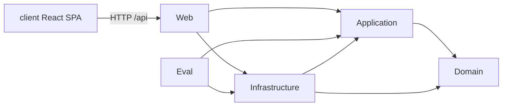
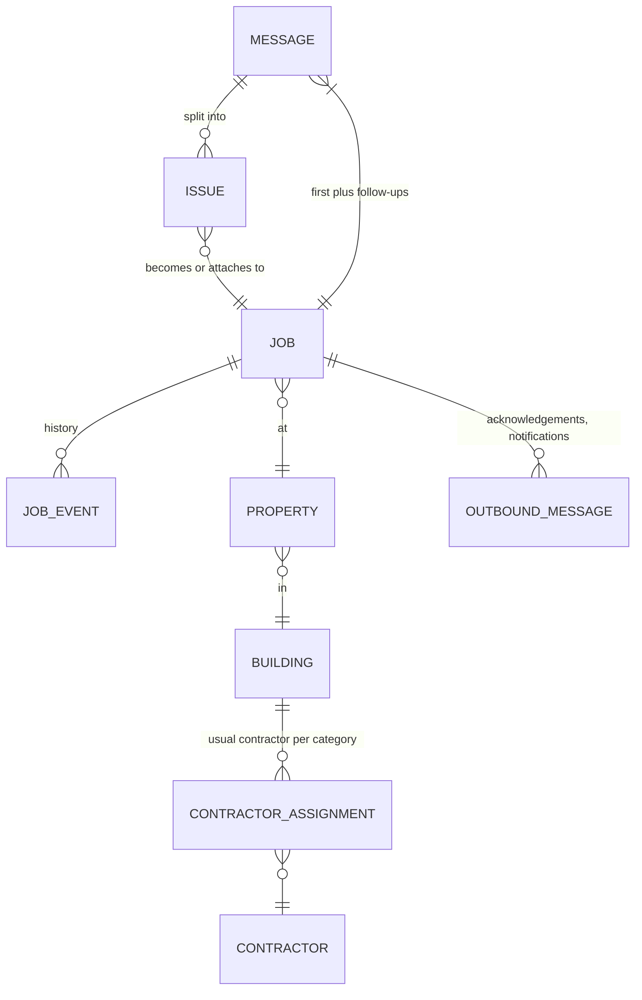
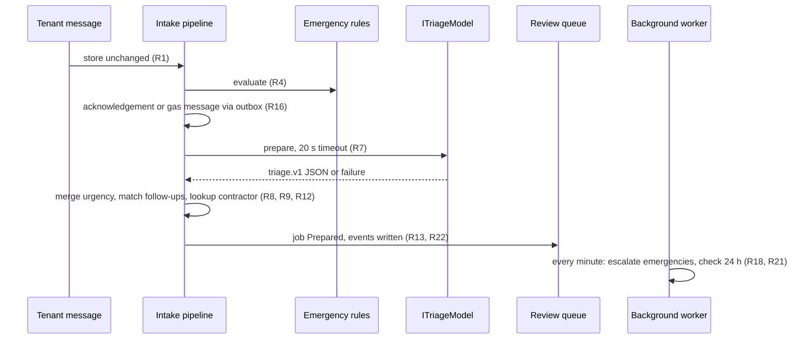

# Architecture Spine — Meridian maintenance triage

## Design Paradigm

One deployable ASP.NET Core process, organised as ports and adapters. The domain and application core know nothing about HTTP, the database or any model provider; adapters plug in at the edges. A React single-page app is built to static files and served by the same process.

| Layer | Project | Holds | May depend on |
| --- | --- | --- | --- |
| Domain | `Meridian.Domain` | Job, Message, Issue, Urgency, Category, JobEvent, state transitions, emergency rules | nothing |
| Application | `Meridian.Application` | Use cases (intake pipeline, review, escalation, attendance, metrics), ports (`ITriageModel`, `IOutbox`, `IClock`, repositories) | Domain |
| Infrastructure | `Meridian.Infrastructure` | EF Core + SQLite, stub and OpenRouter model adapters, simulated outbox, prompt files, seed data | Application, Domain |
| Web | `Meridian.Web` | REST API, background worker, composition root, serves the built SPA | all three |
| Client | `client/` | React SPA | the REST API only |
| Eval | `Meridian.Eval` | Eval runner over the labelled set | Application, Infrastructure |



## Invariants & Rules

### AD-1 — The model sits behind one port [ADOPTED]

- **Binds:** R7, R10, R22, RULE-11, RULE-12
- **Prevents:** model SDK calls spread through the code; a provider swap touching use cases.
- **Rule:** Only `Meridian.Infrastructure` talks to a model. Everything else calls `ITriageModel.PrepareAsync(TriageRequest, CancellationToken) → TriageModelResult`. Implementations: `StubTriageModel` (recorded responses, the default) and `OpenRouterTriageModel` (OpenAI-compatible chat completions), selected at startup: OpenRouter only when `OPENROUTER_API_KEY` is set. The model id comes from config `Triage:Model`.

### AD-2 — A versioned, validated output contract

- **Binds:** R6, R7, R10, R22
- **Prevents:** code trusting free-form model text; two parsers with different ideas of the shape.
- **Rule:** The model must return JSON matching contract `triage.v1`: `issues[]` each with `summary_en`, `category` (enum), `urgency` (enum), `property_text`, `explanation`, `vulnerability_mentioned` (bool), `confidence` (`high|medium|low`), plus `language`. One validator in Application checks it. Invalid output gets one retry, then the issue becomes Unsure (R10). `TriageModelResult` carries the raw output, model id, prompt version, latency and token counts for the event log.

### AD-3 — Deterministic code decides; the AI only proposes

- **Binds:** R4, R5, R8, R9, R12, R17, RULE-2, RULE-4, RULE-5
- **Prevents:** the AI's proposal becoming a decision through a side door.
- **Rule:** The intake pipeline runs in this fixed order: store message → emergency rules → acknowledgement (template) → model preparation (20 s timeout) → urgency merge → follow-up matching → one job per remaining issue → contractor lookup → queue → escalation scheduled. Emergency rules, follow-up matching, contractor lookup, escalation and outbound text are plain C# with unit tests and no model call. A model failure skips only the preparation step (RULE-11).

### AD-4 — Urgency only goes up, except by a person

- **Binds:** R5, R9, RULE-2
- **Prevents:** a later step or a re-preparation silently lowering an emergency.
- **Rule:** `Urgency` is ordered `Routine < Urgent < Emergency`. The only automatic operation is `Job.RaiseUrgency(level, reason)`, which ignores a lower value. Lowering exists only as `Job.SetUrgencyByPerson(level, person, reason)`, called from the review use case, and always writes an event.

### AD-5 — One write path; every change is an event

- **Binds:** R14, R15, R22, R23, R24, RULE-10
- **Prevents:** state changing without a history row; metrics disagreeing with the job view.
- **Rule:** Jobs change state only through domain methods on `Job`, which append a `JobEvent` (type, UTC time, actor, payload JSON). The application layer saves the job and its new events in one transaction. `JobEvent` rows are append-only: never updated or deleted. The numbers page (R24) is computed from events only, never from current job fields.

### AD-6 — The job lifecycle is a fixed state machine

- **Binds:** R13, R14, R15, R19, R20, R21
- **Prevents:** a job reaching a contractor without approval; each feature inventing its own statuses.
- **Rule:** States: `Prepared → Approved → SentToContractor → Attended`, plus `Rejected` from `Prepared`. Escalation (`EscalationState: None | NotifiedRachel | NotifiedBackup | Acknowledged | Failed`) is a separate field, not a lifecycle state. Only `Approved` can move to `SentToContractor` (R15). Illegal transitions throw.

### AD-7 — Tenant and contractor text is fixed templates

- **Binds:** R16, R17, RULE-5, RULE-6
- **Prevents:** model text reaching a tenant; the gas message being reworded.
- **Rule:** Outbound text comes only from templates in `Meridian.Application/Templates` with placeholders for reference, address and category. The gas safety message is a constant. Model output is never interpolated into outbound text.

### AD-8 — Outbound and notifications go through an outbox

- **Binds:** R16, R18, R19, R20
- **Prevents:** sending code scattered across features; the demo needing SMS or email accounts.
- **Rule:** Every acknowledgement, staff notification and contractor message is written as an `OutboundMessage` row (channel, recipient, template id, body, status) through `IOutbox`. The first version's adapter only stores and displays them (simulated sending). A real sender replaces the adapter later.

### AD-9 — Time comes from a clock port; all times UTC

- **Binds:** R16, R18, R19, R21, R24, RULE-8
- **Prevents:** escalation and promise timers that cannot be tested; mixed time zones.
- **Rule:** Code reads time only from `IClock`. Stored times are UTC; the UI shows Europe/London. Working days are Monday to Friday. The 30-minute escalation and 24-hour promise are checked by one background worker every minute; each check is idempotent.

### AD-10 — Data sent to the model is minimal and treated as data

- **Binds:** R7, RULE-14, prd AI never-do list
- **Prevents:** tenant personal data leaking to the provider; instructions inside a message steering the model.
- **Rule:** The model receives the message text and received time only: no sender address or name field. The system prompt is a versioned file (`prompts/triage.v1.md`) and the message is wrapped as quoted data in the user turn. The allowed categories and urgencies are listed in the prompt and enforced by AD-2's validator, so an injected value is rejected.

### AD-11 — Contractor links are capability tokens

- **Binds:** R20
- **Prevents:** a contractor link that opens other jobs; needing contractor accounts.
- **Rule:** Each `SentToContractor` job gets a random, single-job token; the link marks only that job attended and expires when it is attended or rejected.

### AD-12 — The eval runs through the real pipeline

- **Binds:** prd SM-1, SM-7, AI behavior and evaluation
- **Prevents:** an eval that measures the prompt but not the rules and merge the product actually applies.
- **Rule:** `Meridian.Eval` loads `eval/cases/*.json` (message plus expected issues, category, urgency), runs each through the same Application pipeline with the configured `ITriageModel`, and writes `eval/results/<date>-<model>.json` and a Markdown summary. Errors are classed by harm: missed emergency (critical), wrong urgency up (tolerable), wrong category (minor).

### AD-13 — Property and follow-up matching are fixed code

- **Binds:** R7, R8, R11
- **Prevents:** two features resolving "14b Alder Court" to different properties, or grouping messages by different rules.
- **Rule:** The model returns only `property_text`. `PropertyResolver` normalises it and matches it against seeded properties; no match, or more than one, sets the job's property to unresolved and the job goes to the Unsure category for a person to pick. `FollowUpMatcher` attaches an issue to an existing job when the property is the same, the category is the same (or either is Unsure), the job is not `Attended` or `Rejected`, and the job was opened within the last 7 days; otherwise a new job is created.

## Consistency Conventions

| Concern | Convention |
| --- | --- |
| Naming | C# PascalCase; domain nouns exactly as in the PRD glossary (Message, Issue, Job, Follow-up, Urgency, Category). Events are past tense: `MessageReceived`, `RulesApplied`, `JobPrepared`, `JobApproved`. |
| Ids | Guid primary keys. Human job reference `MER-` + zero-padded sequence (e.g. `MER-000123`), shown to tenants. |
| API | REST JSON under `/api`, camelCase, DTOs in Web only (never return entities). Errors as RFC 9457 problem details. |
| Enums on the wire | Strings, not numbers. |
| Config | `appsettings.json` plus environment variables; secrets only from environment (`OPENROUTER_API_KEY`). |
| Logging | `ILogger` structured logging; no message text or tenant data in logs (it lives in events). |
| Acting user | No login in the first version; the SPA has an "acting as" switch (Rachel, backup) recorded as the event actor. |
| Tests | xUnit; domain and application rules are unit-tested with `IClock` faked; one API test via `WebApplicationFactory`. |

## Stack

| Name | Version |
| --- | --- |
| .NET SDK / runtime | 8.0 (SDK 8.0.134) |
| ASP.NET Core | 8.0 |
| EF Core + SQLite provider | 8.0.34 |
| xUnit | 2.9.3 |
| Microsoft.AspNetCore.Mvc.Testing | 8.0.34 |
| Node.js (client build) | 22 |
| React | 19.3.1 |
| Vite | 8.3.5 |
| @vitejs/plugin-react | 6.1.2 |
| TypeScript | 7.0.2 |
| Model provider | OpenRouter, OpenAI-compatible chat completions API; stub by default |

## Structural Seed

```text
src/
  Meridian.sln
  Meridian.Domain/          # entities, enums, emergency rules, state machine
  Meridian.Application/     # pipeline, use cases, ports, validator, templates
  Meridian.Infrastructure/  # EF Core, model adapters, outbox, prompts/, seed data
  Meridian.Web/             # API, background worker, serves client build from wwwroot
  Meridian.Eval/            # eval runner
  Meridian.Tests/           # unit and API tests
  client/                   # React + Vite SPA, builds into Meridian.Web/wwwroot
eval/
  cases/                    # labelled eval cases (JSON)
  results/                  # eval run outputs
run.sh                      # one command: build client, run migrations and seed, start
```





**Deployment and environments.** One environment for the assessment: local machine. `run.sh` (and `run.ps1` for Windows) installs client packages, builds the SPA into `Meridian.Web/wwwroot`, applies EF migrations to `meridian.db`, seeds buildings, contractors and the six forwarded messages, and starts the app on `http://localhost:5080`. No cloud hosting, containers or CI in the first version.

## Capability → Architecture Map

| Capability / Area | Lives in | Governed by |
| --- | --- | --- |
| R1–R3 intake | Application `IntakePipeline`, Web `/api/messages` | AD-3, AD-5 |
| R4–R5 emergency rules | Domain `EmergencyRules` | AD-3, AD-4 |
| R6–R7, R10 AI preparation | Infrastructure model adapters, Application validator | AD-1, AD-2, AD-10 |
| R8 follow-ups | Application `FollowUpMatcher` | AD-3 |
| R9 urgency merge | Domain `Job.RaiseUrgency` | AD-4 |
| R11–R12 contractor map | Infrastructure seed data, Application `ContractorLookup` | AD-3 |
| R13–R15 review | Application review use case, client queue page | AD-5, AD-6 |
| R16–R17 tenant messages | Application templates, `IOutbox` | AD-7, AD-8 |
| R18–R19 escalation | Web background worker, Application `EscalationService` | AD-6, AD-8, AD-9 |
| R20–R21 attendance | Application attendance use case, Web `/c/<token>` | AD-6, AD-9, AD-11 |
| R22–R23 events | Domain `JobEvent`, client job history | AD-5 |
| R24 numbers | Application `MetricsQuery` over events | AD-5 |
| Eval | `Meridian.Eval`, `eval/` | AD-12 |

## Deferred

- **Authentication and roles:** no login in the first version; the acting-as switch stands in. Revisit before any live use.
- **Real email intake and sending, SMS, WhatsApp:** adapters behind `IOutbox` and a new intake endpoint later (R3).
- **UK bank holidays in working days:** Monday to Friday is enough for the demo.
- **Hosting, CI, containers:** local run only for the assessment.
- **Data retention and protection rules (prd OQ-3):** open with the user and Meridian.
- **Which OpenRouter model (prd OQ-5):** chosen against the eval when the key is added.
- **Batching, caching, queueing for ten times the volume:** discussed in AI-DESIGN.md, not built.
